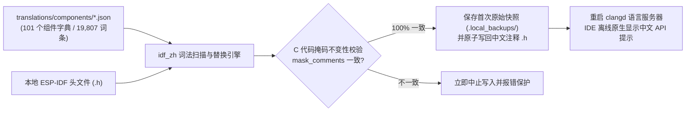

# esp-idf-zh-headers — ESP-IDF 公开 API 头文件简体中文离线汉化包

[](https://github.com/xiaobendaoke/esp-idf-zh-headers/actions/workflows/ci.yml)
[](./LICENSE)
[-red.svg)](https://github.com/espressif/esp-idf)
[-3776AB.svg)](./pyproject.toml)

**[English README](./README_EN.md)**

为 **ESP-IDF** 提供 **100% 公开 API 头文件 Doxygen 简体中文离线注释注入与无损还原**。只需一条命令，即可让 VS Code / Cursor / CLion / Neovim 中的 `clangd` 或 C/C++ IntelliSense 在自动补全与鼠标悬停时**原生离线显示简体中文 API 说明**，无需依赖联网实时翻译插件。

---

## 为什么需要这个项目？

乐鑫官方虽然提供了简体中文版的《ESP-IDF 编程指南》，但由于文档构建架构（Sphinx + Breathe 直接提取 `.h` 头文件中的英文 Doxygen 注释生成 `.inc`），存在两个长期痛点：

1. **IDE 悬停与补全全英文**：本地 SDK `components/` 下的 `.h` 头文件只有纯英文注释（官方 PR 规范强制要求源码注释必须为英文）。
2. **官网中文文档底部的“API 参考”仍是英文**：即使打开官方中文网页，函数原型、参数与结构体字段说明依旧直接嵌入英文注释。

本项目通过**外挂式组件级 JSON 翻译字典 + C 词法掩码不变性校验引擎**，在不改动任何一行有效 C 代码的前提下，实现本地 SDK 头文件的**一键汉化**与**一键无损还原**。

### 核心数据指标（基线：ESP-IDF `v6.1`）

| 指标项 | 实测覆盖数据 |
| :--- | :--- |
| 官方公开 API 头文件清单（`Doxyfile` + `Doxyfile_esp32s3` + `esp_psram.h`） | **375 / 375**（100% 扫描覆盖，其中 371 个含可译注释文件全部汉化，4 个原文件无英文说明注释） |
| 按组件拆分的 JSON 字典文件数（`translations/components/*.json`） | **101 个组件**（`esp_driver_*`、`freertos`、`esp_wifi`、`bt`、`nvs_flash`、`soc` 等） |
| 唯一英文 Doxygen 注释词条数 | **19,807 条**（组件词条总计 **19,892 条**） |
| 头文件注释替换总命中次数（`v6.1` 全量实测） | **22,431 处**（未翻译残留英文注释 **0 处**） |
| 非注释 C 代码字节不变性校验 + `-Wall -Werror` 交叉编译 | **375 / 375 通过（0 错误，0 警告）** |

---

## 工程安全特性

- **C 代码 100% 零侵入保证**：内置 C 词法扫描器（识别字符串字面量、字符常量、块注释与行注释），每次写盘前强制校验 `mask_comments(原文) == mask_comments(译文)`，确保预处理宏、字符串常量、函数签名、结构体定义与 `#endif` 保护宏分毫未动。
- **Doxygen 语法完整性校验**：强制保留原始注释定界符（`/**`、`/**<`、`/*!<`、`///`、`///<`）、`@param` 参数标识符、`@code ... @endcode` 示例代码块与 `SPDX-License-Identifier` 版权标头；杜绝块注释提前出现 `*/` 或单行注释夹带换行符。
- **跨平台 CRLF / LF 自适应**：完美兼容 Windows 下 `git config core.autocrlf=true`（`\r\n`）与 Linux / macOS（`\n`）检出环境，写回时保留原文件换行符风格且不产生 UTF-8 BOM。
- **幂等备份与用户代码保护**：首次应用自动将原始英文头文件快照备份至仓库 `.local_backups/`（不污染 `esp-idf` 目录，即使离线安装包无 `.git` 也可随时一键还原）；还原时若检测到用户手工改过头文件中的 C 代码，默认自动保护跳过并提示。
- **跨芯片与跨小版本高复用**：以原始注释文本为索引键，不仅支持默认的 `esp32s3`，也支持 `--target esp32`、`esp32c3`、`esp32c6`、`esp32p4` 乃至 `--target all`，以及 `v6.0` / `v6.1.x` 等相近版本中所有未变动注释的自动匹配汉化。
- **零第三方依赖**：仅依赖 Python 3.9+ 标准库，直接复用本地已有的系统 Python 或 ESP-IDF Python 虚拟环境即可运行。

---

## 工作原理



---

## 快速开始

### 1. 克隆本仓库

```bash
git clone https://github.com/xiaobendaoke/esp-idf-zh-headers.git
cd esp-idf-zh-headers
```

### 2. 查看本地 ESP-IDF 当前状态（只读扫描）

```bash
# Windows PowerShell / CMD 示例（Linux / macOS 同理）
python idf_zh.py status --idf-path "C:\esp\v6.1\esp-idf"
```

如果终端中已激活 ESP-IDF 环境（已存在 `IDF_PATH` 环境变量），可省略 `--idf-path`：

```bash
python idf_zh.py status
```

### 3. 一键注入简体中文注释

```bash
# 先预览匹配情况（不改动任何文件）
python idf_zh.py apply --idf-path "C:\esp\v6.1\esp-idf" --dry-run

# 正式应用汉化（默认面向 esp32s3 公开头文件）
python idf_zh.py apply --idf-path "C:\esp\v6.1\esp-idf"

# 或同时覆盖本地 ESP-IDF 中所有芯片目标（esp32 / esp32s3 / esp32c3 / esp32c6 / esp32p4 等）
python idf_zh.py apply --idf-path "C:\esp\v6.1\esp-idf" --target all
```

### 4. 清理旧项目 `clangd` 索引缓存并刷新编辑器（关键步骤！）

> [!IMPORTANT]
> 如果你的固件工程此前已经用 `clangd` 打开并后台索引过，工程目录下 `build/.cache/clangd/index/`（或 `.cache/clangd/index/`）中的 `.c.*.idx` 实现文件索引里会缓存汉化前的**旧英文注释**（由于 `.c` 源文件本身未变动，`clangd` 重启后仍会优先读取 `.c.*.idx` 中的旧英文文档覆盖 `.h` 的新中文注释）。

因此首次汉化已有工程后，请先删除该工程下的 `.cache/clangd` 缓存目录，再重启语言服务器：

```powershell
# PowerShell（在你的固件工程目录下执行，将 build 替换为实际构建目录）
Remove-Item -Recurse -Force .\build\.cache\clangd -ErrorAction SilentlyContinue
```

```bash
# Linux / macOS
rm -rf ./build/.cache/clangd ./.cache/clangd
```

随后在编辑器中刷新索引：
- **VS Code / Cursor / Antigravity (`clangd`)**：按 `Ctrl + Shift + P`（macOS 为 `Cmd + Shift + P`），运行 **`clangd: Restart language server`**。
- **VS Code Microsoft C/C++ 插件**：按 `Ctrl + Shift + P`，运行 **`C/C++: Reset IntelliSense Database`**。

现在将鼠标悬停在任意常用 API（如 `i2c_master_transmit_receive`、`xTaskCreatePinnedToCore`、`esp_wifi_init`、`nvs_open`）上，即可直接看到完整的中文功能说明、参数解释与返回值列表！

### 5. 一键无损还原回官方英文原版

当你需要升级 `esp-idf`、执行 `git pull` 或向乐鑫官方提交 PR 时，随时一键恢复：

```bash
python idf_zh.py restore --idf-path "C:\esp\v6.1\esp-idf"
```

---

## 命令行参考

也可通过 `pip install -e .` 安装为全局命令 `idf-zh`，参数与 `python idf_zh.py` 完全一致：

| 命令 | 说明 |
| :--- | :--- |
| `python idf_zh.py status [--idf-path PATH] [--target TARGET] [--component COMP]` | 只读统计目标头文件数、已汉化注释数与待匹配英文注释数 |
| `python idf_zh.py apply [--idf-path PATH] [--target TARGET] [--component COMP] [--dry-run]` | 备份原始头文件并原子注入简体中文注释（支持重复执行，完全幂等） |
| `python idf_zh.py restore [--idf-path PATH] [--target TARGET] [--component COMP] [--dry-run]` | 从本地快照（或 Git `HEAD` 兜底）无损恢复原始英文头文件 |
| `python idf_zh.py validate` | 离线校验内置 101 个组件翻译字典的编码、定界符与 `@param` 完整性 |

**仅汉化单个组件示例**（如只汉化 FreeRTOS 或新版 I2C 驱动）：

```bash
python idf_zh.py apply --idf-path "C:\esp\v6.1\esp-idf" --component freertos
python idf_zh.py apply --idf-path "C:\esp\v6.1\esp-idf" --component esp_driver_i2c
```

---

## 仓库目录结构

```text
esp-idf-zh-headers/
├── .github/                  # GitHub Actions 跨平台自动校验流水线与 Issue/PR 模板
├── src/idf_zh/               # 核心引擎源码（零外部依赖）
│   ├── cli.py                # 命令行交互与结构化日志
│   ├── engine.py             # 词法替换、CRLF 自适应、幂等备份与无损还原
│   └── validator.py          # C 掩码不变性与 Doxygen 语法安全校验器
├── translations/             # 核心中文翻译数据
│   ├── manifest.json         # 基线版本元数据与 375 个公开 API 头文件清单
│   └── components/           # 按 101 个 ESP-IDF 组件拆分的 UTF-8 JSON 字典
├── tests/                    # 单元测试与全量字典完整性自检套件
├── idf_zh.py                 # 免安装快捷启动脚本
├── pyproject.toml            # 标准 Python 包定义
├── CONTRIBUTING.md           # 翻译纠错与新版本适配贡献指南
├── LICENSE                   # Apache License 2.0
└── NOTICE                    # 上游归属与第三方许可证声明
```

---

## 参与贡献

非常欢迎提交 Issue 或 Pull Request 来改进术语准确性或适配新版本 ESP-IDF！
所有翻译按组件存放在 `translations/components/<组件名>.json` 中（例如 `translations/components/esp_wifi.json`），直接修改对应中文词条后运行以下命令通过校验即可提交 PR：

```bash
python idf_zh.py validate
python -m unittest discover -s tests -v
```

详细规范请参阅 [CONTRIBUTING.md](./CONTRIBUTING.md)。

---

## 开源许可与免责声明

- 本工具包及翻译组织工程采用 **[Apache License 2.0](./LICENSE)** 开源许可证发布。
- 字典中所映射的原始英文 API 注释来源于 [espressif/esp-idf](https://github.com/espressif/esp-idf) 及其包含的上游组件（如 FreeRTOS 等），其原始版权与许可归属详见 [NOTICE](./NOTICE)。
- 本项目为社区独立维护的非官方辅助开发工具，与乐鑫信息科技（Espressif Systems）无隶属或官方背书关系。涉及硬件电气特性、寄存器时序或安全关键设计时，请始终以乐鑫官方英文原版技术参考手册（TRM）与头定义为准。
